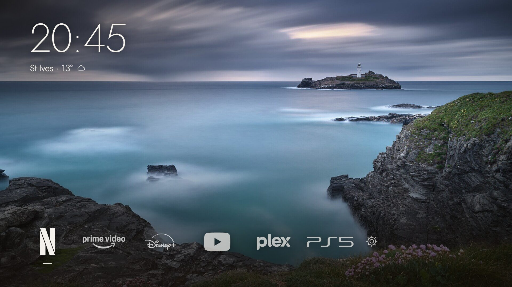

# Lightkeeper

A calm Home screen for LG TVs on older webOS, made to sit beside [GlassHouse](https://github.com/rorygallagher2024/glasshouse).

It shows the time, the weather for one city and a short row of your apps and HDMI inputs over a picture, and keeps LG's ads and suggestions out. The Home key opens it, it comes up when the TV switches on, and you set it up from your phone.


GlassHouse brings its own Home to webOS 9, 10 and 11. Lightkeeper is for the TVs before those, and it started on an LG C1 running webOS 6.5.3.

*[Italiano più sotto](#italiano)*

## Screenshots

| Plain names | Settings on a phone |
|---|---|
|  |  |




Logos are drawn in white. An app Lightkeeper has no logo for shows its own icon from the TV, and an HDMI input shows the device you pick for it.

## What you need

- **An LG webOS TV with root and the [Homebrew Channel](https://github.com/webosbrew/webos-homebrew-channel).** This project does not explain how to root a TV: follow the Homebrew Channel's own guides.
- **[GlassHouse](https://github.com/rorygallagher2024/glasshouse) installed and running** (its dashboard answers on port 8080). Lightkeeper hands the Home key to itself through GlassHouse's remote-key filter. Tested with GlassHouse 0.118.0; see its [documentation](https://rorygallagher2024.github.io/glasshouse/) to install it.
- **A phone or computer on the same network as the TV**, for the settings page.
- An internet connection on the TV for the weather. Everything else works offline.

## Install

1. **Download** `io.github.chiotas.lightkeeper_1.0.1_all.ipk` from the [latest release](https://github.com/chiotas/lightkeeper/releases/latest).
2. **Install it on the TV**, in one of these ways:
   - GlassHouse dashboard → **Apps** tab → *Install app from a URL or file* ([how](https://rorygallagher2024.github.io/glasshouse/dashboard/apps/)). You can also paste the release's link to the `.ipk` there.
   - [webOS Dev Manager](https://github.com/webosbrew/dev-manager-desktop), or `ares-install` from LG's webOS CLI.
3. **Open Lightkeeper once** from the TV's app list. On its first start it asks the Homebrew Channel to set up its settings server and its start-up hook. This takes about ten seconds, and nothing asks you anything.
4. **Press Home.** From now on the Home key opens Lightkeeper, and so does switching the TV on. You can turn off either in the settings.
5. **Set it up** from your phone: on the TV, move to the gear at the end of the row and the address to type appears beside it, something like `http://192.168.1.50:8090`.

**Over SSH instead,** from a computer with this repository and root SSH access to the TV:

```sh
./lightkeeper.sh install 192.168.1.50
```

If your TV needs a particular key, set `LIGHTKEEPER_SSH="ssh -i ~/.ssh/your_tv_key"` first. To update later, install the new `.ipk` over the old one, or run the same command: your settings stay.

## Always the latest version

- **In the Homebrew Channel.** Add Lightkeeper's repository once: Homebrew Channel → the gear at the top → *Add repository* → `https://github.com/chiotas/lightkeeper/releases/latest/download/apps.json`. Lightkeeper then appears in the channel's list, among the other apps. Open it there to install it, and later to update it: the page shows the new version and *Update*. Your settings stay.
- **A link that does not change.** `https://github.com/chiotas/lightkeeper/releases/latest/download/lightkeeper.ipk` always leads to the newest release. Paste it in GlassHouse (*Apps* → *Install app from a URL or file*) or in webOS Dev Manager.

## Set it up

Open **http://&lt;your-tv's-address&gt;:8090** on a phone or computer. On the TV, choose the gear at the end of the row; it opens the same page in the TV's browser and shows the address to type on your phone.

The preview at the top is the Home as the TV draws it, and it changes as you go. Lightkeeper saves each change at once, and the TV shows it within a few seconds.

- **Tiles.** Choose apps and HDMI inputs, which keep the names you gave them on the TV. Put them in order, by dragging them by their handle on a phone or computer or with the arrows, and rename them if you like. Up to fifty: the row slides as you move along it.
- **Names, logos or app icons.** Show the names alone; white logos, with the app's own icon where there is no logo; or every app's own icon from the TV. For each HDMI input you pick the device plugged into it (PlayStation 5, Xbox, Nintendo Switch, Apple TV, Chromecast, Fire TV and more): Lightkeeper guesses it from the name the input has on the TV. With logos or icons, the names can show under every tile, under the selected one only, or not at all, which leaves the icons alone with a short line under the selected one.
- **Background.** Pick one of the nine backgrounds Lightkeeper carries: a photograph of Godrevy Lighthouse, six sea paintings and charts in the public domain, and two quiet gradients, night and dawn. Or upload your own picture: your phone or computer crops it to 16:9 and resizes it to 1920 or 3840 pixels before sending it. The *shade* slider sets how dark the picture is behind the time and the tiles.
- **Clock and weather.** Choose a 24 or 12-hour clock and search for a city (from [Open-Meteo](https://open-meteo.com/)). Pick °C or °F, or turn the weather off.
- **Screen saver.** Pause LG's screen saver for an hour while you try things out. It comes back by itself, as an OLED should not show a still picture for long.
- **Remote and power.** Pick which key opens Lightkeeper: Home, or another key GlassHouse can change on your remote, such as the coloured keys. With Home, pressing Back in the last app also returns to Lightkeeper. *Open at power on* brings Lightkeeper up when the TV switches on over an input or LG's Home. If you switch on with the Netflix button, you stay on Netflix.
- **PIN.** An optional PIN for the settings page.

On the remote: **← →** to move, **OK** to open, **Back** to leave, **↓** for LG's own Home.

## Remove it

Any of these takes it all away:

- the settings page, **Remove Lightkeeper**;
- `./lightkeeper.sh uninstall 192.168.1.50`;
- deleting the app from the TV's app list. Lightkeeper notices within two minutes and cleans up after itself, as long as the TV stays on that long.

All three give the Home key back to LG's Home, remove the start-up hook and delete the settings.

## How it works

- `app/` is the webOS web app: the Home (`index.html`), the backgrounds it carries in `backgrounds/` (listed, with their credits, in `backgrounds/index.json`), and under `service/` a small node server, the settings page and the start-up hook. It is written in plain ES5 so it runs on the old Chromium and node versions these TVs ship.
- The server listens on port 8090. It answers only the TV itself and private network addresses, and only to an IP address or `localhost` in the Host header. It runs no command you send it: the only programs it starts are `luna-send`, with calls fixed in its code, and GlassHouse's `tvwebctl restart`. It checks every setting before saving it, takes only JPEG pictures up to 3840 × 2160 and 12 MB, and accepts writes only with a JSON or JPEG content type, which a web page elsewhere cannot send it.
- What it writes on the TV: `/var/lib/lightkeeper/` (settings and your picture) and a link in `/var/lib/webosbrew/init.d/60-lightkeeper`, pointing into the app. It also adds its own entry to GlassHouse's key map (`/var/lib/tvweb/remotekeys.json` and the `glasshouse.remoteKeys` setting its filter reads), and leaves the keys you set in GlassHouse alone. It touches nothing on the TV's read-only system.
- The log is in `/tmp/lightkeeper.log`.

## Compatibility

Lightkeeper has been tested on one TV. It is written for the older ones (plain ES5 for the Chromium and node versions they ship, and the services GlassHouse already uses on them). The second row comes from people who run it; the rest is a reasoned guess.

| | TVs | What to expect |
|---|---|---|
| **Tested** | LG OLED C1 (OLED65C11LB), webOS 6.5.3, GlassHouse 0.118.0 | Everything in this README. |
| **Reported working** | webOS 2.x (community reports) | Not tried here. People on Reddit run it on webOS 2; a report with the model and what works fills in this row. |
| **Should work** | webOS 3.x to 8.x (LG's 2016–2023 models, up to "webOS 23"), with GlassHouse running | Not tried. The code checks no webOS version and needs nothing newer than the web and node engines of these TVs (node 0.12 on webOS 3 and 4). If GlassHouse's Apps tab offers to change your remote's keys, Lightkeeper can take the Home key. |
| **Should work, with care** | webOS 9 and 10 ("webOS 24" and "25") | Not tried. GlassHouse has its own Home there; turn it off first, as both would claim the Home key. |
| **Partly** | webOS 11 ("webOS 26") | Not tried. GlassHouse changes keys there with LG's own settings, which leave the Home key out, so Lightkeeper cannot take it. The app, the settings and opening at power on should still work. |
| **Not supported** | webOS 1; any TV without root, the Homebrew Channel and GlassHouse | Lightkeeper needs all three, and no one has reported it working on webOS 1. |

**Tried it on another TV?** Please fill in the [Report from your TV](https://github.com/chiotas/lightkeeper/issues/new?template=2-report-from-your-tv.md) form: the model, the webOS version (Settings → General → About this TV) and how it went, good or bad. Reports move TVs up this table.

## Troubleshooting

**The Home key still opens LG's Home.** In the settings, *Remote and power* says what the key is doing. "Active within a minute" means GlassHouse is restarting to put its key filter in place: wait a minute. "GlassHouse is not installed" means Lightkeeper cannot find GlassHouse on the TV: install it first. A GlassHouse update can also reset the keys; changing the key in Lightkeeper's settings sets it again.

**The settings page does not open.** Make sure your phone is on the same network as the TV, and type the address with `http://` and `:8090`. If it still does not answer, open Lightkeeper once from the TV's app list: it starts its server again if needed. Over SSH, `./lightkeeper.sh install <address>` puts everything back in place and keeps your settings.

**Lightkeeper does not come up when the TV switches on.** Check *Open at power on* in the settings. Lightkeeper opens only over an input or LG's Home, so switching on with the Netflix button keeps you on Netflix. After a full restart of the TV, the Homebrew Channel starts Lightkeeper about 40 seconds in.

**Switching on the TV also switches on a console or a streaming box.** That is the TV's own HDMI-CEC, not Lightkeeper: Settings → General → Devices → HDMI Settings → SIMPLINK (HDMI-CEC) → *Auto Power Sync*. Turned off, the console's own button still switches on the TV.

**The screen saver gets in the way while you try things.** *Remote and power* → *Pause for an hour*. It also closes a screen saver already on.

**A tile shows a coloured icon among white logos.** Lightkeeper has no logo for that app, and it could not make the TV's icon white. Choose *Names* or *App icons* instead, or open an issue with the app's name.

**Something else.** The log is in `/tmp/lightkeeper.log` on the TV. Please attach it, with what you did, to an [issue](https://github.com/chiotas/lightkeeper/issues).

## Develop

```sh
./lightkeeper.sh preview    # settings on http://127.0.0.1:8090, the Home on http://127.0.0.1:8091, against a stand-in TV
node test/check.js        # the server's checks
./lightkeeper.sh build      # dist/*.ipk
```

A release carries four files from `dist/`: the package, `io.github.chiotas.lightkeeper_<version>_all.ipk`; the same file as `lightkeeper.ipk`, for the link that leads to the newest release; and the Homebrew Channel's catalog, `apps.json` and `lightkeeper.manifest.json`. The page the channel shows is [docs/homebrew-channel.html](docs/homebrew-channel.html), read from `main`.

```sh
gh release create v1.0.2 dist/io.github.chiotas.lightkeeper_1.0.2_all.ipk dist/lightkeeper.ipk dist/apps.json dist/lightkeeper.manifest.json
```

A new background is a 1920 × 1080 JPEG in `app/backgrounds/`, a 384 × 216 copy in `app/backgrounds/thumbs/`, and an entry in `app/backgrounds/index.json`.

## Contributing

Ideas, reports and pull requests are welcome.

- **Missing a service or a console?** [Open an issue](https://github.com/chiotas/lightkeeper/issues/new/choose) with its name and, if you know it, a link to the official logo. I'll add the name and a white logo.
- **Tried it on another TV?** The *Report from your TV* form takes two minutes and fills in the compatibility table.
- **Pull requests:** keep the code plain ES5, as the older TVs need, and run `node test/check.js` before you send it.

## Credits

- Default background: *Godrevy Lighthouse*, a photograph by [Francesco Gola](https://francescogola.net). © Francesco Gola, all rights reserved; it may be used only as part of Lightkeeper, see [PHOTO-LICENSE.md](PHOTO-LICENSE.md).
- The other backgrounds, cropped to 16:9 from the museums' and the Library of Congress's own images:
  - James McNeill Whistler, *Nocturne: Blue and Gold—Southampton Water*, 1872. Art Institute of Chicago, public domain ([artic.edu](https://www.artic.edu/artworks/56905)).
  - Fitz Henry Lane, *Lumber Schooners at Evening on Penobscot Bay*, 1863. National Gallery of Art, Washington, CC0 ([nga.gov](https://www.nga.gov/collection/art-object-page.57611.html)).
  - Peder Balke, *The North Cape by Moonlight*, 1848. The Metropolitan Museum of Art, CC0 ([metmuseum.org](https://www.metmuseum.org/art/collection/search/441379)).
  - Caspar David Friedrich, *The Monk by the Sea*, 1808–1810. Alte Nationalgalerie, Berlin, public domain ([Wikimedia Commons](https://commons.wikimedia.org/wiki/File:Caspar_David_Friedrich_-_Der_M%C3%B6nch_am_Meer_-_Google_Art_Project.jpg)).
  - James McNeill Whistler, *Nocturne in Black and Gold: Entrance to Southampton Water*, c. 1875–1876. Freer Gallery of Art, Smithsonian, CC0 ([si.edu](https://asia-archive.si.edu/object/F1897.21a-b/)).
  - James Horsburgh, *China Sea, Sheet I*, 1806. Library of Congress, public domain ([loc.gov](https://www.loc.gov/item/84696453/)); shown here in negative.
  - *Night at sea* and *Dawn at sea*: gradients made for Lightkeeper, under its MIT licence.
- Logos: drawings from [Simple Icons](https://simpleicons.org/) 16.35.0 (CC0), and for the brands Simple Icons does not carry, such as Prime Video, Disney+, RaiPlay, Xbox and Nintendo Switch, the brands' own logos from Wikimedia Commons, where they are in the public domain as simple text and shapes (list in `docs/art/logos-commons.tsv`). All are drawn in white for Lightkeeper. The logos and names belong to their owners and are used only to identify apps and devices.
- Icons for LG's own apps, game consoles and plain HDMI: [Phosphor Icons](https://phosphoricons.com/) (MIT) and Google's [Material Symbols](https://fonts.google.com/icons) (Apache 2.0); their licences are in `app/logos/`.
- Typeface: [Jost](https://github.com/indestructible-type/Jost), SIL Open Font License 1.1 (`app/OFL.txt`). The fixed 200, 300 and 500 weights, for engines without variable fonts, are instances of the same file.
- Weather data by [Open-Meteo.com](https://open-meteo.com/), CC BY 4.0.
- [GlassHouse](https://github.com/rorygallagher2024/glasshouse), whose key filter and set-up through the Homebrew Channel Lightkeeper builds on.

## Licence

The code is MIT, © 2026 Francesco Gola: see [LICENSE](LICENSE). The default background photograph is not under the MIT licence: it may be used only as part of Lightkeeper, unmodified. See [PHOTO-LICENSE.md](PHOTO-LICENSE.md).

**Use at your own risk.** Lightkeeper runs as root on a TV that has been modified, and it comes with no warranty. It is not affiliated with or endorsed by LG Electronics. webOS is a trademark of LG Electronics.

---

## Italiano

**Lightkeeper** è una Home calma per le TV LG con webOS vecchi, da usare insieme a [GlassHouse](https://github.com/rorygallagher2024/glasshouse). Mostra l'ora, il meteo di una città e una fila corta di app e ingressi HDMI sopra un'immagine, e tiene fuori pubblicità e suggerimenti di LG. Si apre col tasto Home e all'accensione, e si configura dal telefono. GlassHouse ha la sua Home per webOS 9, 10 e 11; Lightkeeper è per le TV di prima ed è nata su una LG C1 con webOS 6.5.3.

**Cosa serve.** Una TV LG con il **Homebrew Channel** ([webosbrew](https://github.com/webosbrew/webos-homebrew-channel)) e **GlassHouse** ([documentazione](https://rorygallagher2024.github.io/glasshouse/)) già installati. Questo progetto non spiega come installarli: seguite le loro guide.

**Installazione.**
1. Scaricate il `.ipk` dall'[ultima release](https://github.com/chiotas/lightkeeper/releases/latest).
2. Installatelo dalla scheda *Apps* di GlassHouse (*Install app from a URL or file*), con webOS Dev Manager o con `ares-install`.
3. Aprite Lightkeeper una volta dall'elenco delle app. Al primo avvio chiede al Homebrew Channel di preparare il suo server e l'avvio automatico: una decina di secondi, senza domande.
4. Premete Home. Da qui in poi il tasto Home e l'accensione aprono Lightkeeper; si possono spegnere entrambi dalle impostazioni.

In alternativa, da un computer via SSH come root: `./lightkeeper.sh install 192.168.1.50`.

**Sempre l'ultima versione.**
- Nel Homebrew Channel aggiungete una volta il repository di Lightkeeper: ingranaggio in alto → *Add repository* → `https://github.com/chiotas/lightkeeper/releases/latest/download/apps.json`. Lightkeeper compare nella lista del canale insieme alle altre app: da lì si installa e, quando esce una versione nuova, si aggiorna con *Update*. Le impostazioni restano.
- L'indirizzo `https://github.com/chiotas/lightkeeper/releases/latest/download/lightkeeper.ipk` porta sempre all'ultima release: incollatelo in GlassHouse (*Apps* → *Install app from a URL or file*) o in webOS Dev Manager.

**Impostazioni.** Aprite **http://&lt;indirizzo-della-TV&gt;:8090** dal telefono o dal computer, oppure scegliete l'ingranaggio in fondo alla fila sulla TV. L'anteprima in alto è la Home come la disegna la TV e cambia mentre si regola. Ogni modifica si salva subito. Si possono scegliere:

- le voci, cioè app e ingressi HDMI coi loro nomi, fino a cinquanta, da riordinare trascinandole o con le frecce e da rinominare;
- solo nomi, loghi bianchi o icone delle app; con loghi e icone, i nomi sotto tutte le voci, solo sotto quella scelta o da nessuna parte (solo icone); per ogni ingresso HDMI l'apparecchio collegato, che Lightkeeper indovina dal nome dell'ingresso;
- lo sfondo, tra i nove che Lightkeeper porta con sé (la foto del faro di Godrevy, sei marine e carte nautiche di pubblico dominio, due sfumature) oppure una vostra immagine, ritagliata e ridimensionata a 1920 o 3840 pixel sul telefono prima dell'invio; e l'intensità del velo;
- l'orologio a 24 o 12 ore;
- la città del meteo, cercata su Open-Meteo, in °C o °F;
- una pausa di un'ora dello screensaver di LG, per fare prove;
- il tasto che apre Lightkeeper; con Home, anche Indietro dall'ultima app torna qui;
- l'apertura all'accensione;
- un PIN facoltativo per la pagina.

Sul telecomando: **← →** per scegliere, **OK** per aprire, **Indietro** per uscire, **↓** per la Home di LG.

**Disinstallazione.** Dalla pagina (*Remove Lightkeeper*), con `./lightkeeper.sh uninstall 192.168.1.50`, o cancellando l'app dalla TV, che se ne accorge entro due minuti se resta accesa. Il tasto Home torna alla Home di LG, l'avvio automatico sparisce e le impostazioni vengono cancellate.

**Compatibilità.** Provata solo su LG OLED C1 (OLED65C11LB), webOS 6.5.3, GlassHouse 0.118.0. Su Reddit c'è chi la usa su webOS 2.x. Dovrebbe funzionare sui webOS da 3.x a 8.x con GlassHouse, ma lì non è provata. Sui webOS 9 e 10 va spenta prima la Home di GlassHouse. Sul webOS 11 non può prendere il tasto Home. Non sono supportati il webOS 1 e le TV senza root, Homebrew Channel e GlassHouse. La tabella completa è nella sezione *Compatibility*. Se la provate su un'altra TV, compilate il modulo [Report from your TV](https://github.com/chiotas/lightkeeper/issues/new?template=2-report-from-your-tv.md) con modello, versione e com'è andata.

**Problemi.** Se il tasto Home apre ancora la Home LG, nelle impostazioni la sezione *Remote and power* dice cosa sta facendo: «Active within a minute» vuol dire aspettare un minuto. Se la pagina non si apre: stessa rete della TV, indirizzo con `http://` e `:8090`, poi aprite Lightkeeper una volta dalla TV. Se accendendo la TV si accende anche la console, è il SIMPLINK della TV: Impostazioni → Generali → Dispositivi → Impostazioni HDMI → SIMPLINK → *Sincronizzazione accensione automatica*. Il registro è in `/tmp/lightkeeper.log` sulla TV.

**Contribuire.** Suggerimenti, segnalazioni e pull request sono benvenuti. Manca un servizio o una console? [Aprite una segnalazione](https://github.com/chiotas/lightkeeper/issues/new/choose) col nome e, se c'è, il link al logo ufficiale: aggiungo nome e logo bianco. Se la provate su un'altra TV, il modulo *Report from your TV* richiede due minuti.

**Licenza.** Il codice è MIT, © 2026 Francesco Gola. La foto dello sfondo predefinito, *Godrevy Lighthouse* di [Francesco Gola](https://francescogola.net), ha una licenza sua ([PHOTO-LICENSE.md](PHOTO-LICENSE.md)): tutti i diritti riservati, si usa solo dentro Lightkeeper e senza modifiche. Gli altri sfondi e i loro crediti sono nella sezione *Credits*. I loghi appartengono ai rispettivi proprietari e sono usati solo per identificare app e apparecchi; i disegni vengono da Simple Icons (CC0) e da Wikimedia Commons (pubblico dominio). **Uso a proprio rischio**: Lightkeeper gira come root su una TV modificata e non ha alcuna garanzia. Non è affiliata né approvata da LG Electronics.
