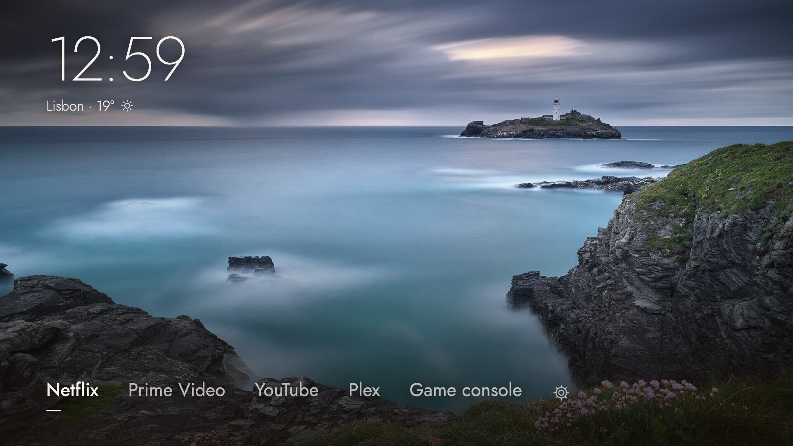
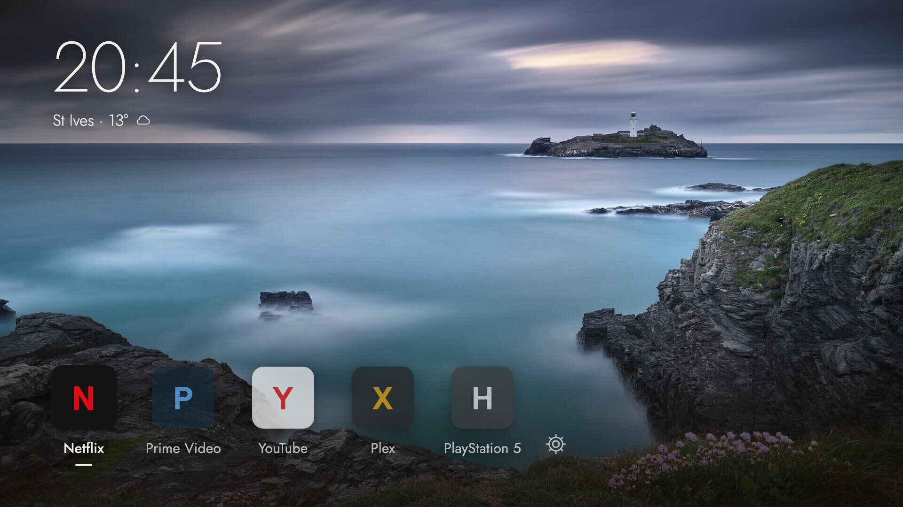
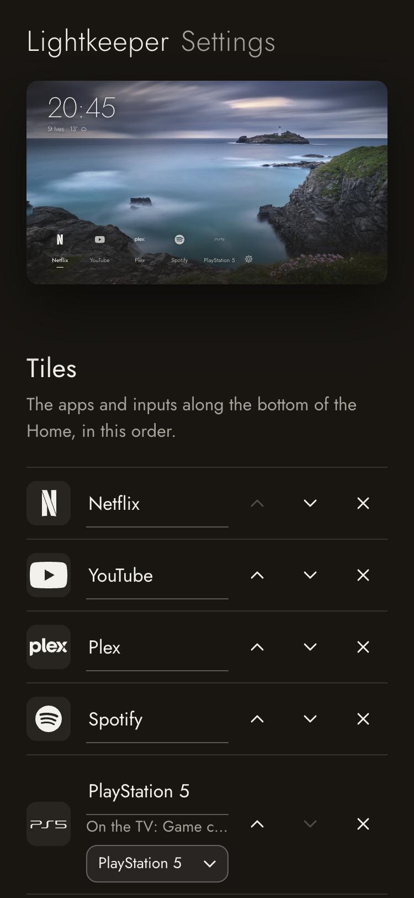
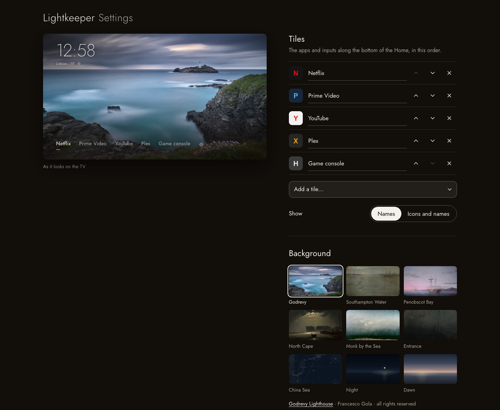

# Lightkeeper

A calm Home screen for LG TVs on older webOS, made to sit beside [GlassHouse](https://github.com/rorygallagher2024/glasshouse).

It shows the time, the weather for one city and a short row of your apps and HDMI inputs over a picture, and keeps LG's ads and suggestions out. The Home key opens it, it comes up when the TV switches on, and you set it up from your phone.



GlassHouse brings its own Home to webOS 9, 10 and 11. Lightkeeper is for the TVs before those, and it started on an LG C1 running webOS 6.5.3.

*[Italiano più sotto](#italiano)*

## Screenshots

| Logos and names | Settings on a phone |
|---|---|
|  |  |



Logos are drawn in white. An app Lightkeeper has no logo for shows its own icon from the TV, and an HDMI input shows the device you pick for it.

## What you need

- An LG TV with the **Homebrew Channel** installed: see [webosbrew](https://github.com/webosbrew/webos-homebrew-channel) and its guides.
- **GlassHouse** installed and running on the TV: see the [GlassHouse documentation](https://rorygallagher2024.github.io/glasshouse/). Lightkeeper uses its remote-key filter to take over the Home key.
- A phone or computer on the same network as the TV.

This project does not explain how to get the Homebrew Channel onto a TV. Follow those projects' own guides.

## Install

**From the package.** Download `io.github.chiotas.lightkeeper_1.0.0_all.ipk` from the [latest release](https://github.com/chiotas/lightkeeper/releases/latest) and install it as you install any `.ipk`:

- GlassHouse: **Apps** tab, *Install app from a URL or file* ([how](https://rorygallagher2024.github.io/glasshouse/dashboard/apps/)), or
- [webOS Dev Manager](https://github.com/webosbrew/dev-manager-desktop), or
- `ares-install` from LG's webOS CLI.

Then open **Lightkeeper** once from the TV's app list. On its first start it asks the Homebrew Channel to set up its small settings server and its start-up hook, and from then on it runs by itself.

**Over SSH,** from a computer with this repository and SSH access to the TV as root:

```sh
./lightkeeper.sh install 192.168.1.50
```

If your TV needs a particular key, set `LIGHTKEEPER_SSH="ssh -i ~/.ssh/your_tv_key"` first.

Out of the box, Lightkeeper takes the Home key and opens when the TV comes on. You can turn off both in the settings.

## Set it up

Open **http://&lt;your-tv's-address&gt;:8090** on a phone or computer. On the TV, choose the gear at the end of the row; it opens the same page in the TV's browser and shows the address to type on your phone.

The preview at the top is the Home as the TV draws it, and it changes as you go. Lightkeeper saves each change at once, and the TV shows it within a few seconds.

- **Tiles.** Choose apps and HDMI inputs, which keep the names you gave them on the TV. Put them in order and rename them if you like. Up to twelve.
- **Names, logos or app icons.** Show the names alone; white logos, with the app's own icon where there is no logo; or every app's own icon from the TV. For each HDMI input you pick the device plugged into it (PlayStation 5, Xbox, Nintendo Switch, Apple TV, Chromecast, Fire TV and more): Lightkeeper guesses it from the name the input has on the TV.
- **Background.** Pick one of the nine backgrounds Lightkeeper carries: a photograph of Godrevy Lighthouse, six sea paintings and charts in the public domain, and two quiet gradients, night and dawn. Or upload your own picture: your phone or computer crops it to 16:9 and resizes it to 1920 or 3840 pixels before sending it. The *shade* slider sets how dark the picture is behind the time and the tiles.
- **Clock and weather.** Choose a 24 or 12-hour clock and search for a city (from [Open-Meteo](https://open-meteo.com/)). Pick °C or °F, or turn the weather off.
- **Screen saver.** Pause LG's screen saver for an hour while you try things out. It comes back by itself, as an OLED should not show a still picture for long.
- **Remote and power.** Pick which key opens Lightkeeper: Home, or another key GlassHouse can change on your remote, such as the coloured keys. With Home, pressing Back in the last app also returns to Lightkeeper. *Open at power on* brings Lightkeeper up when the TV switches on over an input or LG's Home. If you switch on with the Netflix button, you stay on Netflix.
- **PIN.** An optional PIN for the settings page.

On the remote: **← →** to move, **OK** to open, **Back** to leave, **↓** for LG's own Home.

## Remove it

Any of these takes it all away:

- the settings page, **Remove Lightkeeper**;
- `./lightkeeper.sh uninstall 192.168.1.50`;
- deleting the app from the TV's app list. Lightkeeper notices within two minutes and cleans up after itself, as long as the TV stays on that long.

All three give the Home key back to LG's Home, remove the start-up hook and delete the settings.

## How it works

- `app/` is the webOS web app: the Home (`index.html`), the backgrounds it carries in `backgrounds/` (listed, with their credits, in `backgrounds/index.json`), and under `service/` a small node server, the settings page and the start-up hook. It is written in plain ES5 so it runs on the old Chromium and node versions these TVs ship.
- The server listens on port 8090. It answers only the TV itself and private network addresses, and only to an IP address or `localhost` in the Host header. It runs no command you send it: the only programs it starts are `luna-send`, with calls fixed in its code, and GlassHouse's `tvwebctl restart`. It checks every setting before saving it, takes only JPEG pictures up to 3840 × 2160 and 12 MB, and accepts writes only with a JSON or JPEG content type, which a web page elsewhere cannot send it.
- What it writes on the TV: `/var/lib/lightkeeper/` (settings and your picture) and a link in `/var/lib/webosbrew/init.d/60-lightkeeper`, pointing into the app. It also adds its own entry to GlassHouse's key map (`/var/lib/tvweb/remotekeys.json` and the `glasshouse.remoteKeys` setting its filter reads), and leaves the keys you set in GlassHouse alone. It touches nothing on the TV's read-only system.
- The log is in `/tmp/lightkeeper.log`.

## Compatibility

| TV | Status |
|---|---|
| LG OLED C1 (OLED65C11LB), webOS 6.5.3, GlassHouse 0.118.0 | Tested |
| Other webOS 4, 5 and 6 TVs | Not tested. Written for them: ES5, node 0.12 and up, Chromium 53 and up |
| webOS 9 and 10 | Not tested. GlassHouse has its own Home there, and Lightkeeper on the Home key would take its place |
| webOS 11 | Not tested. GlassHouse changes keys there in another way, so Lightkeeper cannot take the Home key; the rest should work |

If you try it on another TV, open an issue and say how it went.

## Develop

```sh
./lightkeeper.sh preview    # settings on http://127.0.0.1:8090, the Home on http://127.0.0.1:8091, against a stand-in TV
node test/check.js        # the server's checks
./lightkeeper.sh build      # dist/*.ipk
```

A new background is a 1920 × 1080 JPEG in `app/backgrounds/`, a 384 × 216 copy in `app/backgrounds/thumbs/`, and an entry in `app/backgrounds/index.json`.

## Credits

- Default background: *Godrevy Lighthouse*, a photograph by [Francesco Gola](https://francescogola.net). © Francesco Gola, all rights reserved; it may be used only as part of Lightkeeper, see [PHOTO-LICENSE.md](PHOTO-LICENSE.md).
- The other backgrounds, cropped to 16:9 from the museums' and the Library of Congress's own images:
  - James McNeill Whistler, *Nocturne: Blue and Gold—Southampton Water*, 1872. Art Institute of Chicago, public domain ([artic.edu](https://www.artic.edu/artworks/56905)).
  - Fitz Henry Lane, *Lumber Schooners at Evening on Penobscot Bay*, 1863. National Gallery of Art, Washington, CC0 ([nga.gov](https://www.nga.gov/collection/art-object-page.57611.html)).
  - Peder Balke, *The North Cape by Moonlight*, 1848. The Metropolitan Museum of Art, CC0 ([metmuseum.org](https://www.metmuseum.org/art/collection/search/441379)).
  - Caspar David Friedrich, *The Monk by the Sea*, 1808–1810. Alte Nationalgalerie, Berlin, public domain ([Wikimedia Commons](https://commons.wikimedia.org/wiki/File:Caspar_David_Friedrich_-_Der_M%C3%B6nch_am_Meer_-_Google_Art_Project.jpg)).
  - James McNeill Whistler, *Nocturne in Black and Gold: Entrance to Southampton Water*, c. 1875–1876. Freer Gallery of Art, Smithsonian, CC0 ([si.edu](https://asia-archive.si.edu/object/F1897.21a-b/)).
  - James Horsburgh, *China Sea, Sheet I*, 1806. Library of Congress, public domain ([loc.gov](https://www.loc.gov/item/84696453/)); shown here in negative.
  - *Night at sea* and *Dawn at sea*: gradients made for Lightkeeper, under its MIT licence.
- Logos: drawings from [Simple Icons](https://simpleicons.org/) 16.35.0 (CC0), and for the brands Simple Icons does not carry, such as Prime Video, Disney+, RaiPlay, Xbox and Nintendo Switch, the brands' own logos from Wikimedia Commons, where they are in the public domain as simple text and shapes (list in `docs/art/logos-commons.tsv`). All are drawn in white for Lightkeeper. The logos and names belong to their owners and are used only to identify apps and devices.
- Typeface: [Jost](https://github.com/indestructible-type/Jost), SIL Open Font License 1.1 (`app/OFL.txt`). The fixed 200, 300 and 500 weights, for engines without variable fonts, are instances of the same file.
- Weather data by [Open-Meteo.com](https://open-meteo.com/), CC BY 4.0.
- [GlassHouse](https://github.com/rorygallagher2024/glasshouse), whose key filter and set-up through the Homebrew Channel Lightkeeper builds on.

## Licence

The code is MIT, © 2026 Francesco Gola: see [LICENSE](LICENSE). The default background photograph is not under the MIT licence: it may be used only as part of Lightkeeper, unmodified. See [PHOTO-LICENSE.md](PHOTO-LICENSE.md).

**Use at your own risk.** Lightkeeper runs as root on a TV that has been modified, and it comes with no warranty. It is not affiliated with or endorsed by LG Electronics. webOS is a trademark of LG Electronics.

---

## Italiano

**Lightkeeper** è una Home calma per le TV LG con webOS vecchi, da usare insieme a [GlassHouse](https://github.com/rorygallagher2024/glasshouse). Mostra l'ora, il meteo di una città e una fila corta di app e ingressi HDMI sopra un'immagine, e tiene fuori pubblicità e suggerimenti di LG. Si apre col tasto Home e all'accensione, e si configura dal telefono. GlassHouse ha la sua Home per webOS 9, 10 e 11; Lightkeeper è per le TV di prima ed è nata su una LG C1 con webOS 6.5.3.

**Cosa serve.** Una TV LG con il **Homebrew Channel** ([webosbrew](https://github.com/webosbrew/webos-homebrew-channel)) e **GlassHouse** ([documentazione](https://rorygallagher2024.github.io/glasshouse/)) già installati. Questo progetto non spiega come installarli: seguite le loro guide.

**Installazione.** Scaricate il `.ipk` dall'[ultima release](https://github.com/chiotas/lightkeeper/releases/latest). Installatelo dalla scheda *Apps* di GlassHouse (*Install app from a URL or file*), con webOS Dev Manager o con `ares-install`. Poi aprite Lightkeeper una volta dall'elenco delle app: al primo avvio chiede al Homebrew Channel di preparare il suo server e l'avvio automatico. Da un computer, via SSH come root: `./lightkeeper.sh install 192.168.1.50`. Appena installata, prende il tasto Home e si apre all'accensione; si può spegnere tutto dalle impostazioni.

**Impostazioni.** Aprite **http://&lt;indirizzo-della-TV&gt;:8090** dal telefono o dal computer, oppure scegliete l'ingranaggio in fondo alla fila sulla TV. L'anteprima in alto è la Home come la disegna la TV e cambia mentre si regola. Ogni modifica si salva subito. Si possono scegliere:

- le voci, cioè app e ingressi HDMI coi loro nomi, in ordine e rinominabili;
- solo nomi, loghi bianchi o icone delle app; per ogni ingresso HDMI l'apparecchio collegato, che Lightkeeper indovina dal nome dell'ingresso;
- lo sfondo, tra i nove che Lightkeeper porta con sé (la foto del faro di Godrevy, sei marine e carte nautiche di pubblico dominio, due sfumature) oppure una vostra immagine, ritagliata e ridimensionata a 1920 o 3840 pixel sul telefono prima dell'invio; e l'intensità del velo;
- l'orologio a 24 o 12 ore;
- la città del meteo, cercata su Open-Meteo, in °C o °F;
- una pausa di un'ora dello screensaver di LG, per fare prove;
- il tasto che apre Lightkeeper; con Home, anche Indietro dall'ultima app torna qui;
- l'apertura all'accensione;
- un PIN facoltativo per la pagina.

Sul telecomando: **← →** per scegliere, **OK** per aprire, **Indietro** per uscire, **↓** per la Home di LG.

**Disinstallazione.** Dalla pagina (*Remove Lightkeeper*), con `./lightkeeper.sh uninstall 192.168.1.50`, o cancellando l'app dalla TV, che se ne accorge entro due minuti se resta accesa. Il tasto Home torna alla Home di LG, l'avvio automatico sparisce e le impostazioni vengono cancellate.

**Compatibilità.** Provata su LG OLED C1 (OLED65C11LB), webOS 6.5.3, GlassHouse 0.118.0. Le altre versioni non sono provate.

**Licenza.** Il codice è MIT, © 2026 Francesco Gola. La foto dello sfondo predefinito, *Godrevy Lighthouse* di [Francesco Gola](https://francescogola.net), ha una licenza sua ([PHOTO-LICENSE.md](PHOTO-LICENSE.md)): tutti i diritti riservati, si usa solo dentro Lightkeeper e senza modifiche. Gli altri sfondi e i loro crediti sono nella sezione *Credits*. I loghi appartengono ai rispettivi proprietari e sono usati solo per identificare app e apparecchi; i disegni vengono da Simple Icons (CC0) e da Wikimedia Commons (pubblico dominio). **Uso a proprio rischio**: Lightkeeper gira come root su una TV modificata e non ha alcuna garanzia. Non è affiliata né approvata da LG Electronics.
